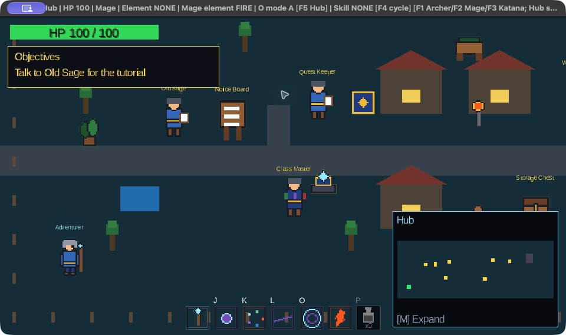
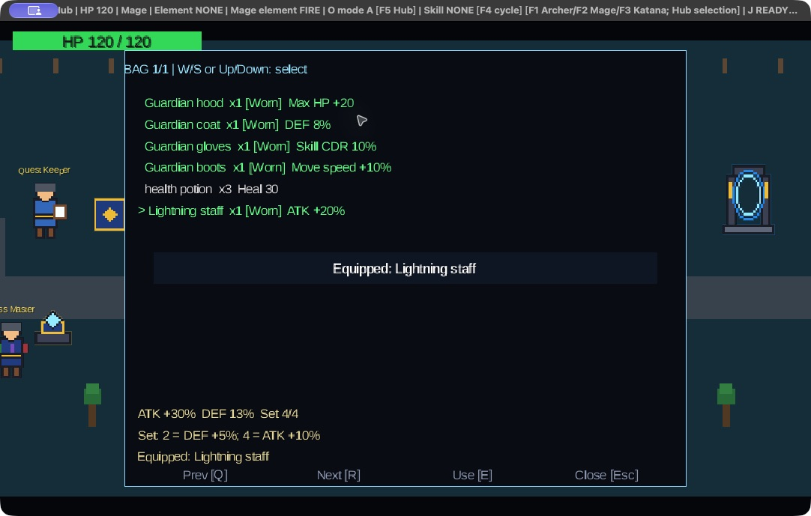
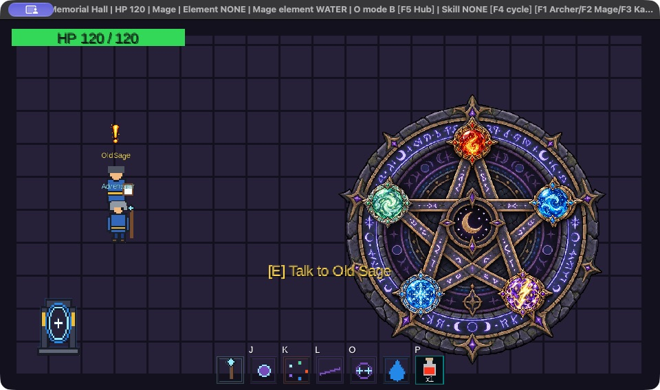
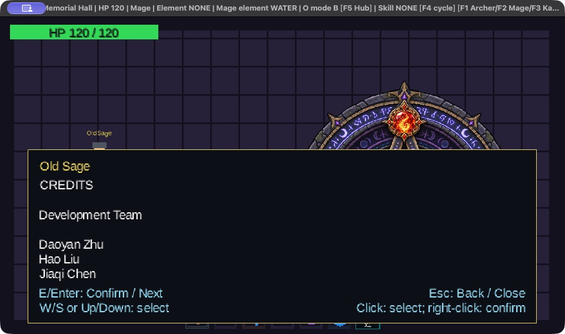

# COMP2120 Group Game

Current implementation reviewed on 2026-10-02 against commit `7fea86a`.
See the [documentation index](docs/README.md) for feature reports and verification evidence.
The working-tree Training HUD overlap fix was compiled and visually verified on 2026-10-03;
its separate results are in the [playtest report](docs/PLAYTEST_REPORT.md#training-overlap-fix-and-verification).

## Game overview

A desktop top-down action RPG built with Java and LibGDX. Explore a shared Hub, choose
Archer, Mage or Katana, practise skills, and challenge five elemental guardians. Each
class has J/K/L skills and two selectable O ultimates. Defeat each distinct guardian to
light its stone in Memorial Hall and unlock the Old Sage's ending conversation and credits.
Rematches remain available with increasing health and attack frequency.

The game includes NPC dialogue, quest-controlled portal travel, elemental reactions,
Boss traits, equipment and upgrades, potions, inventory/storage, two save slots,
a title menu, settings, an in-game pause menu, music and debug tools. The engine uses
shared movement, collision, combat, AI, map and persistence components. The automated
game tester runs command/action-to-state scenarios through these components using JUnit.

## Current game screenshots

Native captures from 2026-10-03, source `1ae3c78`. The [playtest report](docs/PLAYTEST_REPORT.md)
explains the position-only test fixtures, actual results and remaining checks.





See the [screenshot gallery](docs/ART_INTEGRATION.md#native-screenshot-gallery) for save slots
and Training. The follow-up reached all five guardian wins, the Hall ending and Credits; Wind
was completed by the user. The report discloses the travel-position fixtures.





## Install and run

Install **JDK 25** and make it available to Gradle (normally through `JAVA_HOME` and `PATH`).
The build requests a Java 25 toolchain and emits Java 17 bytecode; Java 17 bytecode is not
a promise that the configured desktop launch works on every Java 17 runtime. A desktop
with a working graphics/audio backend is needed to play. Automated model tests need no game window.

From the repository root:

```sh
cd Activity_2
java -version
./gradlew --version
./gradlew lwjgl3:run
```

On Windows use `./gradlew.bat` in place of `./gradlew`. If the Unix wrapper lacks execute
permission after extraction, run `chmod +x gradlew` from this directory.
The first build needs network access to download Gradle and Maven dependencies. No system
Gradle, manually downloaded JARs, database or external map pack is required.

| Dependency | Repository configuration |
| --- | --- |
| Gradle wrapper | 9.7.1, with distribution checksum |
| LibGDX | 1.14.2 |
| LWJGL3 | 3.4.1 |
| JUnit Jupiter | 5.13.4 |
| Java toolchain / compilation target | 25 / `--release 17` |

The Gradle launch supplies native-access flags and macOS `-XstartOnFirstThread`.
For an IDE, import `Activity_2` as a Gradle project and use the `lwjgl3:run` task.
A direct IDE launch of `au.edu.anu.comp2120.lwjgl3.Lwjgl3Launcher` must use the desktop
runtime classpath/resources and those JVM flags. Runtime assets are packaged from `assets/`;
launching from a different working directory does not require copying them.

## Build, test and package

Run these commands from `Activity_2`:

```sh
./gradlew clean build javadocAudit --no-daemon
./gradlew test --rerun-tasks --no-daemon
./gradlew core:javadoc
./gradlew lwjgl3:installDist
```

The first command builds both modules, runs tests, creates desktop distributions and audits
JavaDoc for production/test code including private members, with doclint and warnings as errors.
The second explicitly reruns tests. Ordinary API documentation is in
`core/build/docs/javadoc/`; audit output is under each module's `build/docs/javadoc-audit/`.

HTML test reports are in `core/build/reports/tests/test/index.html` and
`lwjgl3/build/reports/tests/test/index.html`; JUnit XML is in each module's
`build/test-results/test/`. For scenario selection and expected results, see
[Automated game tester](docs/TEST_COVERAGE_REVIEW.md).

`lwjgl3:installDist` creates `lwjgl3/build/install/lwjgl3/`, containing a `bin/lwjgl3`
launcher (`lwjgl3.bat` on Windows) and its `lib/` dependencies. Keep the whole installation
folder together; the desktop JAR alone is not a self-contained executable.
Build distribution scripts on the target OS, because macOS startup flags are selected at build time.
ZIP/TAR distributions are generated in `lwjgl3/build/distributions/`.

Repository [CI](../.gitlab-ci.yml) uses a Docker executor with `eclipse-temurin:25-jdk`
and runs the first command. There is no project Dockerfile/Compose setup for playing the GUI.
The latest verified evidence recorded here is **1,302 passing tests** at `1a2c60c`;
see [the exact CI record and limitations](docs/TEST_COVERAGE_REVIEW.md#recorded-result).

## Start a game

Startup opens **New Game / Continue / Settings / Quit**. Use W/S or arrows and E/Enter,
or click a row. New Game starts in Hub as Mage with an empty bag; the chest contains four
Guardian armour pieces and three potions. It does not delete either existing save.
Continue selects the newest readable slot by save timestamp and attempts full restoration.
It is disabled when neither slot is readable; invalid snapshot data produces a load failure.

Title-menu Settings stores music volume (0–100) and fullscreen preference in
`${user.home}/.comp2120-game/settings.properties`. Defaults are 50% and windowed mode.
Use A/D or Left/Right on the volume row, or drag the slider. Settings are independent of
saved progress. The Esc menu's volume control changes the current game's gain and survives
an in-game restart, but does not write this preference file.

## Controls

| Context | Controls |
| --- | --- |
| Move | WASD; diagonal input is normalized |
| Abilities | J light attack, K class special, L dash, O selected ultimate; once per press |
| Potion | P uses one carried potion when alive and injured |
| NPC/chest | E when nearby |
| Bag | B opens/closes; W/S or arrows select; E/Enter or right-click equips, unequips or uses |
| Storage | A/D or Left/Right selects column; W/S selects row; E/Enter or right-click transfers a whole stack; B switches to bag |
| Item pages | Q/R or PageUp/PageDown; footer buttons also work |
| NPC choices | W/S or arrows; E/Enter confirms; left-click selects and right-click activates |
| Map | M expands/closes outside Memorial Hall when detailed HUD is visible; Esc closes |
| Pause | Esc opens menu; an already open panel closes first |
| Saves | F5 manual save; F9 Manage saves; Esc menu offers both |
| Debug console | F10 or backtick; Enter submits; Esc closes |
| Class shortcuts | F1 Archer, F2 Mage, F3 Katana in an available, living Hub state |
| Debug element | F4 changes the class definition's outgoing elemental tag in Hub; Mage's own element uses K |
| Practice reset | R resets HP/skills and Training score outside Battle; also accepted in Hub and Memorial Hall when no panel owns input |

On macOS, function keys may need Fn. F5 is the manual-save shortcut; choose the O mode
at Class Master. Bag, chest, dialogue, expanded map, console and pause menu stop gameplay
simulation. Closing a panel consumes that frame's input.

## First playthrough

1. Speak to **Old Sage** in Hub for guidance. The objective tracker below HP and NPC marker
   direct the introductory sequence. The Notice Board also explains controls and saving.
2. Visit **Class Master** to select a class and O mode. Each class remembers its own A/B choice.
3. Visit the **Weapon Merchant** for the one-time Lightning staff. Open the **Storage Chest**,
   transfer armour/potions into your bag, then equip through B. The merchant tops up combined
   bag/chest potion stock to three and upgrades carried gear to +1/+2 using Boss cores.
4. At **Portal Guide**, choose Training Ground, close dialogue and walk into the Hub portal.
   Practise on the immortal stationary target. Its upward projectiles test defence; R resets
   the practice state. Speak to the Training exit NPC to return.
5. In Hub, accept a guardian at **Quest Keeper**, then ask **Portal Guide** to open Battle.
   Acceptance alone leaves the portal closed. Walk into it to enter the selected arena.
6. Victory returns you to Hub with full HP, grants the reward once, records progress and
   attempts an automatic checkpoint. Defeat also returns/heals you but grants no reward;
   the accepted task remains available for retry. Simultaneous death counts as defeat.
7. After all five distinct guardians, speak to Hub Old Sage for the Hall direction, select
   Memorial Hall at Portal Guide and speak to the Hall Old Sage for the one-time ending.
   Merely entering the Hall does not play it. The Hall is also visitable before completion.

| Class | J | K | O A / O B |
| --- | --- | --- | --- |
| Archer | Straight arrow | Five-arrow fan | Fixed Arrow Rain / temporary untargetability |
| Mage | Selected-element bolt | Cycle Fire → Water → Lightning → Ice → Wind | Prepared Magic Circle / rapid random-element double bolts |
| Katana | Facing slash | Parry and counter dash | Counter Stance / Dragon Thrust with confirmed-hit follow-up |

Untargetability changes AI selection; existing attacks can still hit. See
[class skills](docs/FINAL_CLASS_SKILLS_REPORT.md), [reactions](docs/ELEMENT_REACTION_COMPLETION_REPORT.md)
and [guardian traits](docs/BOSS_TRAIT_REPORT.md) for mechanics and current base tuning.

## Saving and restarting

Slots are `${user.home}/.comp2120-game/saves/manual.properties` and `automatic.properties`.
Manual saves replace only the manual slot, with overwrite confirmation. Successful Boss
returns replace only the automatic slot. Saving, loading and deleting require a living,
idle player in Hub or Memorial Hall; Training/Battle are excluded, even when paused.

Manage saves offers load/delete for each slot with confirmation. Loading replaces the live
timeline, without merging progress or writing either file. A later victory may overwrite the
automatic slot with progress from an older loaded timeline. Restart game creates a fresh
session and retains both files. Enabling any console cheat blocks save writes until a fresh
session, even if cheats are subsequently disabled or a file is loaded.
See [Save/load](docs/SAVE_LOAD_REPORT.md) for validation, persisted fields and error behavior.

## Engine and documentation

`core` contains gameplay, screens, persistence and tests. `lwjgl3` supplies desktop startup,
native dependencies and resource packaging. World positions use bottom-left coordinates.
There are eight maps: Hub (1080 × 400), Memorial Hall (640 × 360), Training and five Battle
arenas (1600 × 1200 each). The 640 × 360 camera follows/clamps within the map. Current built-in
interiors are open; boundary collision remains active, and wall tests use explicit obstacle fixtures.

See [Architecture](docs/ARCHITECTURE.md) and [Integration](docs/INTEGRATION_REPORT.md) for module
ownership, frame ordering and configuration points. [Art integration](docs/ART_INTEGRATION.md)
explains the current HUD, pixel art and presentation/testing boundary.

## Scope decisions and remaining limits

The separate achievement subsystem and NPC following were dropped as non-core features.
Achievements also depended on save/load, which was completed relatively late, leaving no time
to implement achievement persistence. The guided tutorial was reduced to NPC/Notice Board
instructions and the current objective tracker. Full crafting/forging/enchanting was reduced
to merchant gear upgrades. Damage-number display settings were not implemented. These are
scope reductions of non-core features, not unfinished requirements of the existing save system.

There is no arbitrary mid-battle saving, dynamic body-to-body collision, external map-file
loader or multi-profile save UI. Bosses share an attack-pattern framework with distinct traits;
numerical balance is still adjustable. The JUnit scenarios do not automate native rendering,
audio or an entire mouse/keyboard campaign. Remaining manual acceptance and screenshot needs
are listed in the [tester guide](docs/TEST_COVERAGE_REVIEW.md#manual-acceptance-still-needed).

## Contributors and assets

Contributors: Daoyan Zhu (`u7782042`), Jiaqi Chen (`u7851266`) and Hao Liu (`u7998420`).
See [contribution evidence](docs/ARCHITECTURE.md#contribution-and-planning-evidence) for areas
and traceability. Visual/audio provenance is documented in [assets/README.md](assets/README.md).
The source-code license is at [repository LICENSE.md](../LICENSE.md).
