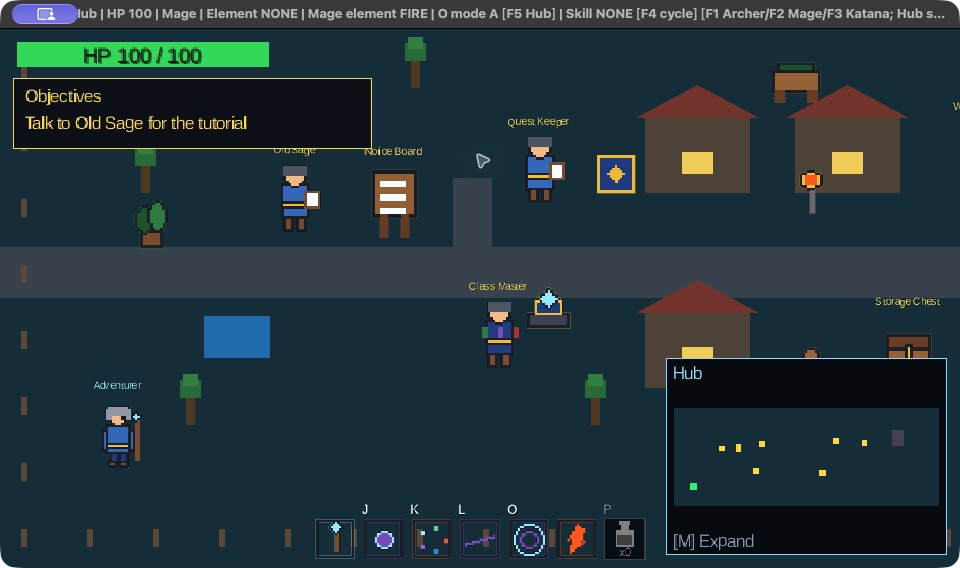
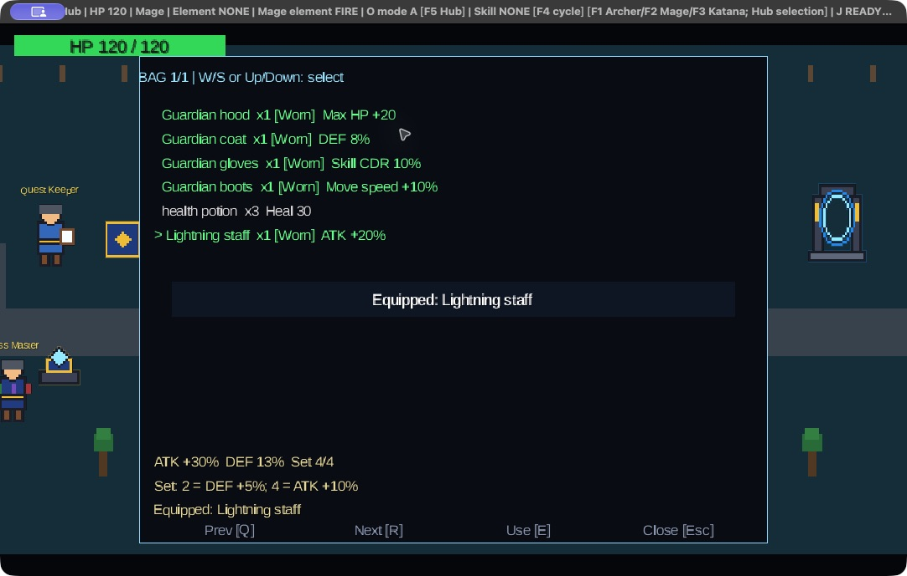
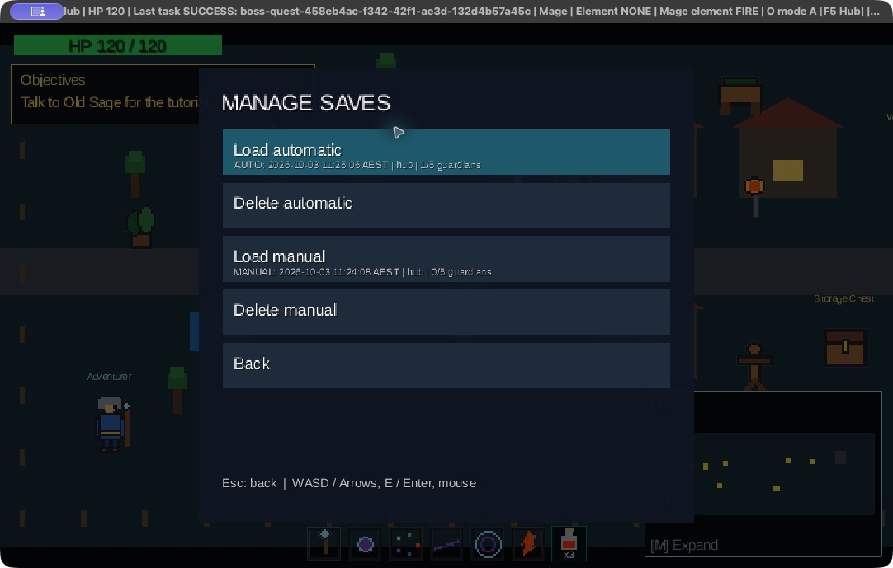
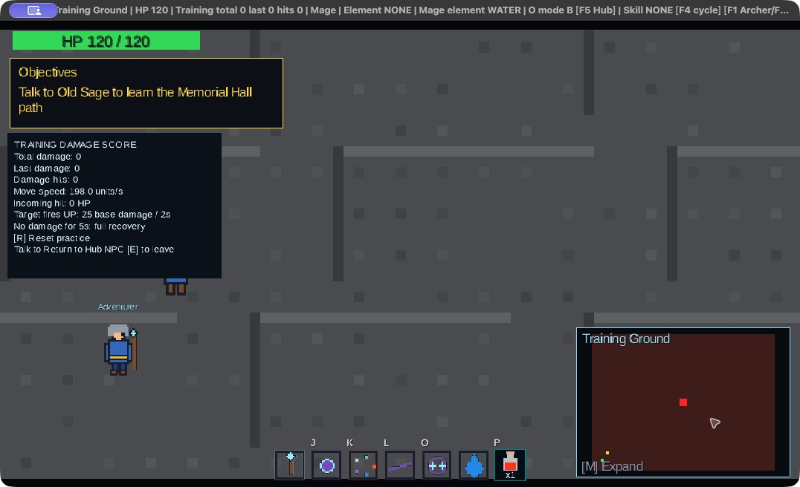
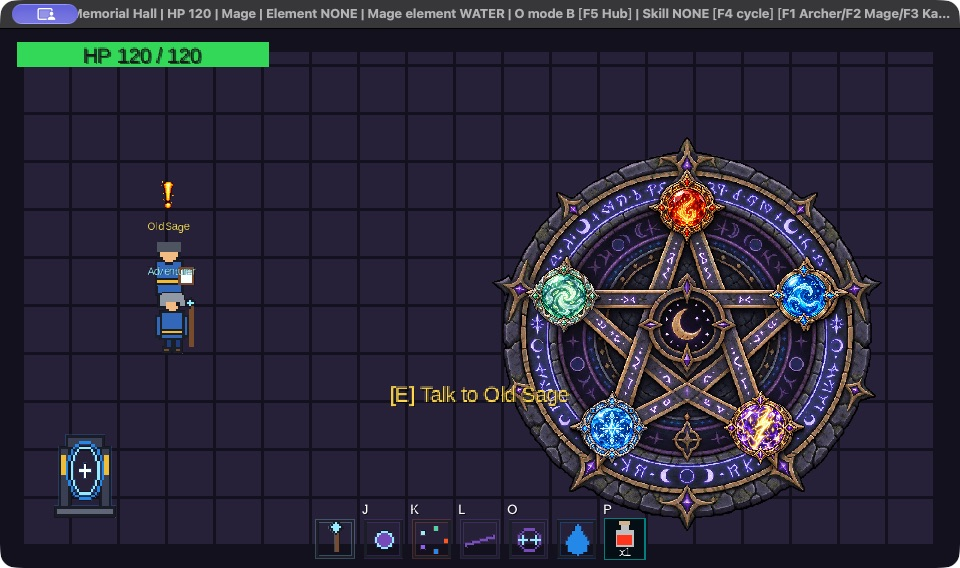
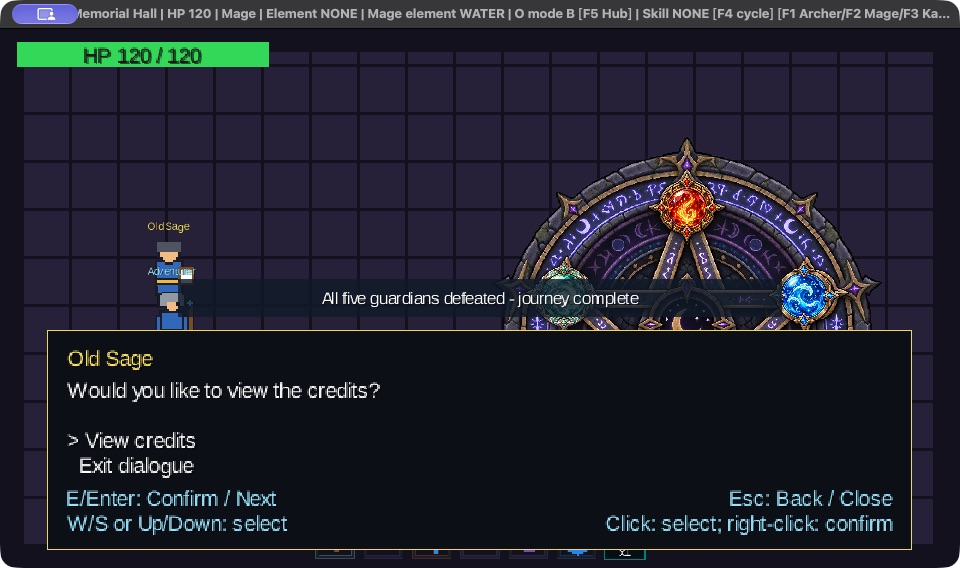
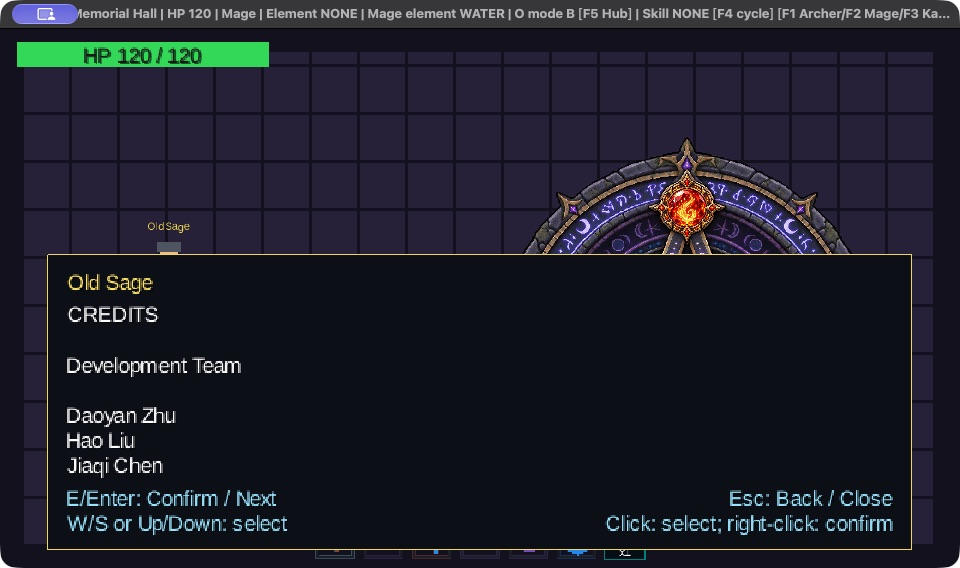

# Art and presentation integration

Reviewed against `7fea86a` on 2026-10-02. The current art directory and manifest both contain
**232 PNG images**. Sources: [ArtAssets](../core/src/main/java/au/edu/anu/comp2120/screen/ArtAssets.java),
[SceneArt](../core/src/main/java/au/edu/anu/comp2120/screen/SceneArt.java),
[HudLayout](../core/src/main/java/au/edu/anu/comp2120/screen/HudLayout.java).

## Resources and ownership

The desktop module packages the shared `assets/` directory into its runtime classpath/JAR.
It excludes `art_resources/**`, `.DS_Store` and `.gitkeep`. Runtime paths are relative to the
assets root. [ASSET_MANIFEST.csv](../assets/art/ASSET_MANIFEST.csv) records each PNG path,
source filename and dimensions. The pack's prose description is in
[art/README.txt](../assets/art/README.txt); recorded provenance is in
[asset attribution](../assets/README.md).

ArtAssets lazily owns/disposes nearest-filtered textures and horizontal-strip frames. SceneArt
selects animation/VFX from read-only gameplay observations. PlaceholderRenderer retains camera,
viewport and scene responsibility while delegating imported-art drawing. No texture dimensions
enter health, movement, collision, map admission or skill damage.

CombatSystem exposes a bounded 128-event HitFeedback mailbox for settled geometry/element/reaction/
block observations. Reading it cannot deal damage; draining consumes observations once. Travel
clears old scene effects, animation references and combat scope. Outcome presentation retains
only immutable result/class data, not a live Boss.

## Current visuals

- Three classes: directional movement/idle, J/K/L/O presentation, hits and follow-through.
- Five guardian appearances and elemental arenas, shared pattern animations, phase/hit effects.
- Portals, NPCs, props/decorations, arrows, elemental bolts, skill areas, reactions and statuses.
- Memorial Hall circle and five stones: earned stones light up; unearned stones remain dim.
- Class/skill/Mage-element icons and cooldown labels, plus a procedural P potion bottle/count.
- Geometric Hub/Hall floor and UI panels where no imported background/icon is used.

Five Mage elemental bolt images are copied into `art/projectiles/boss/*_bolt.png`; these are
the displayed Boss flight images, rendered at doubled dimensions. The older `*_projectile.png`
files remain in the asset pack but are not the current Boss flight selection. Boss warning
art is `art/boss/common/attack_warning.png`, shown over the Boss with source aspect preserved
alongside its red prepared area during the 0.8-second windup.

Animation is presentation-only: short gameplay windows may finish before every strip frame
plays. Guardians share pattern/art selection infrastructure while differing in trait, speed
and element; there are not five completely independent movesets.

## World and camera

Hub is 1080 × 400 world units, Memorial Hall 640 × 360, and Training/five Battle maps each
1600 × 1200. Camera view is 640 × 360 with follow/clamp and letterboxing. Painted arena borders
do not add collision obstacles; all current interiors are open. Boss/Training target body
centres start at (800, 600), with safe fallback placement where necessary.

The Hub uses fixed NPC/prop positions from GameConfig. Hall has its Sage on the left and
stone circle on the right; its return portal is at (32, 32), with entry (100, 48) outside the
trigger. Sprite placement does not override these world coordinates or arrival protection.

Training independently randomizes arena and guardian appearance per visit, including possible
repeats. R retains the visit's art and actor positions. The underlying target remains an immortal
stationary TrainingDummy with fixed upward test shots, not the pictured guardian's AI/trait.

## HUD and status

The current HUD includes HP, wrapped objectives below HP, minimap, skills/elements/potions,
dialogue/item panels, menus and feedback. No coordinate or top-right weapon HUD is drawn.
Hall hides minimap and objective panel to show the stones/Sage. Outside Hall, the current live
Boss/Training target is red on the map and Player green; returning to Hub removes the target mark.
M expands the map to fit 92% of window width and 88% of height, preserving proportions.

HudLayout uses a 960 × 540 reference. Base scale caps at 1.4, separate skill scale at 1.8;
objective/minimap panel scale is 0.8 of skill scale. Detailed HUD requires at least 640 × 360,
health at least 320 × 180. The potion count uses fixed readable metrics: grey `x0`, `x1`–`x999`,
then `999+`; exact stock remains in the bag. This bottle is geometry, not a PNG/manifest addition.

StatusLabels can stack up to five labels above an actor, placing control effects first:
FROZEN, STAGGERED, CHARGED, VULNERABLE, INVULNERABLE and Fire's BURNING xN where relevant.
Existing status icons/overlays remain; burning uses text without a separate burning icon.

Victory/failure shows a gold/red three-second non-blocking Hub banner with outcome artwork.
It expires using UI time, does not delay travel/healing and cannot claim rewards. Other operation
feedback uses centred four-second translucent toasts with a final 0.6-second fade.

## Audio and verification

Three streamed WAV tracks are documented in [audio/README.md](../assets/audio/README.md).
Music selection follows map and five-stone completion, independently of screen artwork.

From Activity_2:

```sh
./gradlew core:test --tests '*ArtIntegrationTest' --tests '*HudLayoutTest' \
  --tests '*PotionFontLayoutTest' --tests '*StatusLabelsTest' \
  --tests '*MemorialHallTest' --tests '*OutcomeBannerTest'
./gradlew lwjgl3:test --tests '*RuntimeAssetsTest'
```

The local audit checked current manifest/file count and paths. These tests check selection,
geometry/layout/font models, outcomes and packaged resources. [Recorded CI](TEST_COVERAGE_REVIEW.md#recorded-result)
does not establish a new GPU/framebuffer or audio-device acceptance run. Old temporary asset-import
paths and counts have been removed from this current report.

Real captures from 2026-10-03 are included below. The [playtest report](PLAYTEST_REPORT.md)
records their source revision, native environment, scenario fixtures and observations. Still
inspect all class bars, representative Boss attacks/warnings, resize/HiDPI and pointer alignment.
Hall ending and all Credits pages were captured in the follow-up. The Training overlap has
subsequently been fixed and checked in a freshly compiled native app; stale title-bar help
remains unresolved. The Training panel follows the measured objective bottom with a scaled gap.
These files are available for later Wiki use; the published Wiki has not been updated.

## Native screenshot gallery



Fresh New Game: Mage, Hub objective, HP and skill bar.



Actual chest/merchant equipment: HP 120, four-piece set and worn staff.



One real Fire victory: AUTO has 1/5 guardians; the older MANUAL remains 0/5.



Updated working-tree build: the complete Training panel is below the wrapped objective.
Screenshots 20–21 are retained as explicitly historical before-fix evidence in the playtest record.

The [complete screenshot index](screenshots/README.md) includes title/settings, fullscreen,
manual load confirmation, potion/map, battle save rejection and relaunch/Continue, plus the
completed five-guardian route, victory banners, Hall ending and all Credits pages.



Five actual distinct wins light the complete seal. Wind was completed by the user.



After the three ending lines, the game confirms journey completion and offers Credits.



Development Team page. Screenshots 34–38 retain every Credits page.
