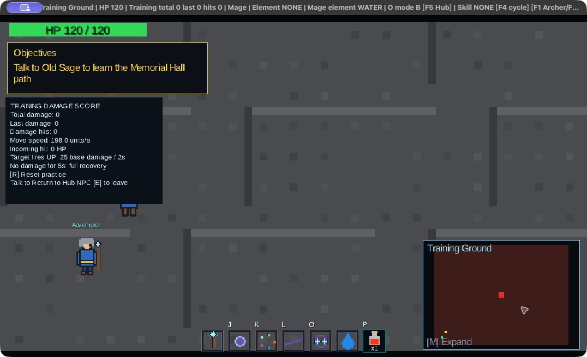

# Native playtest — 2026-10-03

This records a desktop UI session continued through all five guardian wins, the Memorial Hall
ending and all five Credits pages. Fire, Water, Lightning and Ice were defeated through agent
UI operation; the user took over and defeated Wind, confirming normal play without debug
features. Position-only fixtures were used for travel preparation, so this is not an uninterrupted
walk-through campaign. Screenshots were captured from the running game; they are not mockups.
The published Wiki was not changed.

## Version, environment and setup

- Source: `1ae3c781e4b400b31773ec68269f22a525b2cd9f`, branch `update-activity2-docs`,
  with uncommitted documentation changes. The changes from `7fea86a` to this commit
  only add Activity_3 Markdown; Activity_2 game source/assets/build files are unchanged.
- Date/time: 2026-10-03, initial checks 11:13–11:28 AEST, continued through the ending at about 12:00 AEST (Australia/Sydney).
- Environment: macOS 27.0.1 (26A434), ARM64, JDK 25.0.4.1, LibGDX/LWJGL3 desktop.
- The user launched the current Gradle build, then a temporary `jpackage --type app-image`
  wrapper named `COMP2120Playtest.app` so the desktop tool could address its window.
  The wrapper uses current compiled core/desktop classes and current assets, with
  dependency JARs from the existing distribution. It is not a test of the release ZIP.
- Isolated home: `/private/tmp/comp6120-playtest-20261003/home`. Real user saves were
  not used. Both save slots and settings belong to this disposable test session.
- Window captures include the title bar. Captures include 960 × 540 game content,
  a larger window and 1920 × 1080 fullscreen. This was not an exhaustive resize matrix.

The ordinary launch instructions remain in the [game README](../README.md#install-and-run).
The temporary package is session equipment, not an additional project dependency.

## Scenario preparation and limits

The desktop tool's instantaneous WASD presses did not reliably move the player. L dash
and edge-triggered menu/skill keys worked. Therefore the NPC and portal scenarios used
the game's real F9 load UI after changing **only `location.x` and `location.y`** in the
isolated manual save. The positions were chest `(565,120)`, merchant `(630,245)`,
Quest Keeper `(320,240)`, Portal Guide `(740,245)`, portal approach `(790,260)`,
Class Master `(295,130)`, Hub Sage `(160,221)` and Hall Sage approach `(100,140)`.
These are test setup coordinates, not game controls or evidence of normal walking.

Inventory, equipment, quest acceptance, portal permission, damage, victory, reward and
autosave were obtained through actual gameplay/UI. No god mode, one-shot damage, no-CD,
Boss-health edit, seeded victory or seeded reward was used. The initial dash/save/load
position-restoration check occurred before any position fixture was introduced.

## Executed checks

| ID | Steps and expected result | Observed result | Evidence |
| --- | --- | --- | --- |
| N01 | Fresh launch; Continue should be unavailable; New Game should open Hub | Continue disabled; keyboard navigation skipped it; New Game produced Mage, HP 100/100, empty bag and tutorial objective | [Title](screenshots/01-title.jpg), [Hub](screenshots/04-hub.jpg) |
| N02 | Change title Settings with keyboard; toggle fullscreen and back | Volume changed 50 → 52; fullscreen rendered at 1920 × 1080; returned to windowed mode | [Settings](screenshots/02-settings.jpg), [Fullscreen](screenshots/03-fullscreen-settings.jpg) |
| N03 | F5 save; L dash; F9 load manual; cancel once, then confirm | Save summary shown; cancel retained live state; confirmed load restored pre-dash position and displayed Loaded MANUAL | [Slots](screenshots/05-save-manager.jpg), [Confirmation](screenshots/06-load-confirmation.jpg), [Restored Hub](screenshots/07-restored-hub.jpg) |
| N04 | At chest fixture, transfer four armour pieces and three potions; equip armour through bag | Chest transfer and equipment succeeded; HP 120/120, ATK +10%, DEF 13%, Set 4/4 | [Chest](screenshots/08-storage.jpg), [Equipment](screenshots/09-equipped-inventory.jpg) |
| N05 | Press P at full health; open M map | Full-health feedback shown and potion count stayed 3; expanded Hub map displayed NPC markers | [Potion feedback](screenshots/10-potion-full-health.jpg), [Map](screenshots/11-expanded-map.jpg) |
| N06 | At merchant fixture, claim staff twice; attempt upgrade without cores; equip staff | One staff only; upgrade reported missing material; equipped total ATK +30%, DEF 13%, Set 4/4 | [Upgrade list](screenshots/12-merchant-upgrades.jpg), [Equipped staff](screenshots/13-equipped-weapon.jpg) |
| N07 | Accept Fire Sentinel at Quest Keeper; choose Battle at Portal Guide; dash into portal from approach fixture | Quest became ACTIVE; Guide opened route; actual portal entry loaded Crossroads with Fire Sentinel 400/400 | [Accepted quest](screenshots/14-quest-accepted.jpg), [Battle](screenshots/15-battle-save-blocked.jpg) |
| N08 | During battle, press O and F5; repeat O after ordinary cooldowns | F5 rejected unsafe save; three Mage O casts reduced Boss HP 400 → 208 → 16 → defeat; returned to Hub with victory banner, restored HP and autosave-success toast | [Save rejection](screenshots/15-battle-save-blocked.jpg), [Resulting slots](screenshots/16-victory-autosave.jpg) |
| N09 | Load automatic slot and inspect inventory | AUTO showed 1/5 guardians while older MANUAL showed 0/5; loaded bag contained one sentinel-core and retained equipment/potions | [Independent slots](screenshots/16-victory-autosave.jpg), [Restored reward](screenshots/17-restored-victory-reward.jpg) |
| N10 | Quit application; relaunch; inspect Settings; choose Continue | Volume 52 and fullscreen Off persisted; Continue selected AUTO and displayed Loaded AUTO without changing either slot | [Persisted settings](screenshots/18-settings-after-relaunch.jpg), [Continue](screenshots/19-continue-after-relaunch.jpg) |
| N11 | Choose Training via Guide; enter real portal from approach fixture; cast O; press R | Training score increased; R reset total/last/hits to 0 and all skills to READY; pause menu disabled manual saving | [Training](screenshots/20-training.jpg), [Reset](screenshots/21-training-reset.jpg) |

The generated `automatic.properties` was also inspected: `quest.done.FIRE=true`,
`quest.wins.FIRE=1`, other wins zero, `quest.active=` empty, `metadata.slot=AUTO`,
and one `sentinel-core` in the bag. Its recorded time is 2026-10-03 11:25:06 AEST.
This first checkpoint establishes the Fire victory. The follow-up below extends the same
progression to five distinct wins and the ending.
The initial Fire victory banner and missing-material toast were observed live; those retained screenshots
show their resulting slot/inventory state rather than those transient messages.

## Five guardians, Memorial Hall and Credits follow-up

| ID | Steps and expected result | Observed result | Evidence |
| --- | --- | --- | --- |
| N12 | Accept Water, Lightning and Ice individually; Guide opens each route; enter and defeat them | Three additional wins using ordinary Mage O cooldowns; each returned to Hub, restored HP and wrote AUTO; Lightning storm reduced player HP to 112 during the encounter | [Water victory](screenshots/22-water-victory.jpg), [Lightning victory](screenshots/23-lightning-victory.jpg), [Ice victory](screenshots/24-ice-victory.jpg) |
| N13 | Fight Wind; inspect defeat/retry; complete the final guardian | Mage and Archer agent attempts failed under pursuit/input latency; failure returned to Hub at HP 120 with Wind task retained. The user then took over and won normally, explicitly confirming no debug use. The agent verified five wins and AUTO afterwards | [Wind combat](screenshots/25-wind-battle.jpg), [Defeat return](screenshots/26-wind-defeat-return.jpg), [Five-win AUTO](screenshots/27-five-guardians-autosave.jpg) |
| N14 | After 5/5, finish Hub Sage guidance, choose Hall at Guide and enter its portal | Objective changed to Hall direction; actual portal loaded Memorial Hall; all five stones lit, Sage marker visible, minimap/objectives hidden | [Hub Sage](screenshots/28-hub-completion-guidance.jpg), [Hall](screenshots/29-memorial-hall-five-stones.jpg) |
| N15 | Interact with Hall Sage and advance the ending | All three ending lines rendered, followed by “All five guardians defeated - journey complete” and View credits/Exit dialogue choice | [Ending 1](screenshots/30-ending-guardians-fallen.jpg), [Ending 2](screenshots/31-ending-seal-restored.jpg), [Ending 3](screenshots/32-ending-journey-complete.jpg), [Completion and Credits choice](screenshots/33-credits-choice.jpg) |
| N16 | Select View credits; advance each page; close, save in Hall, reload MANUAL | Special Thanks, Development Team, Art/Audio, Tools and Thank You pages rendered. Closing returned to Hall; manual save stored ending completion and load restored Hall with all five stones | [Thanks](screenshots/34-credits-special-thanks.jpg), [Team](screenshots/35-credits-development-team.jpg), [Art/audio](screenshots/36-credits-art-audio.jpg), [Tools](screenshots/37-credits-tools.jpg), [Final page](screenshots/38-credits-thank-you.jpg), [Restored Hall](screenshots/39-hall-ending-restored.jpg) |

The final Wind AUTO was written at **11:53:32 AEST**. Its five `quest.done.*` flags are true,
each `quest.wins.*` is 1, active task is empty, and the bag contains five sentinel-cores.
The user-operated Wind fight was not fully observed by the agent, and its transient victory
banner was not captured. Screenshot 27 proves the resulting five-guardian AUTO, while
screenshot 33 captures the actual all-five journey-completion feedback in the Hall.

After completing Credits, the **11:58:16 AEST** MANUAL contains `location.map=memorial-hall`,
`quest.ending=true`, `quest.memorialRevealed=true` and all five wins. This file was read back,
then loaded through F9; screenshot 39 shows the restored Hall. The independent AUTO remains
the five-win Hub checkpoint before the ending. No completed flags or rewards were edited.

## Observed issues and inconclusive input

1. **Outdated title-bar help:** `O mode A [F5 Hub]` remains visible although F5 actually
   saves. Current documentation uses Class Master for O-mode selection.
2. **Off-screen Mage targeting:** from the Crossroads entry, O damaged the off-screen
   Fire Sentinel while it remained IDLE, allowing the three-cast victory without taking
   damage. Record as a range/AI balance concern for review; this does not validate Boss
   telegraphs, dodging, close-range attacks or the intended encounter difficulty.
3. **Training overlap — fixed in the working tree:** the original build put Objectives over
   the Training information (historical screenshots 20–21). The follow-up below verifies
   the panels stacked with a gap, including a wrapped two-line objective.
4. **Small save-summary text:** unavailable-slot diagnostics containing the full temporary
   path render very small in the initial save manager. See screenshot 05.
5. **Inconclusive pointer/held-key checks:** the automated slider click/drag did not change
   the value; instantaneous WASD did not establish continuous movement. Keyboard settings
   worked. These observations alone do not prove physical mouse/WASD controls are broken.

## Training overlap fix and verification

After the campaign capture, `GameScreen.java` was changed in the working tree. The objective
renderer now returns its actual lower edge after measuring wrapped text; Training is drawn
below that edge with an 8 × Training-scale gap. When Objectives is hidden, Training retains
its original top anchor. Both panels remain below inventory/dialogue overlays.

Screenshots 01–39 represent the original `1ae3c78` game code. Screenshots 40–41 show the
uncommitted Training layout fix compiled from the current source; they are not evidence that
the old binary was already fixed. The replacement temporary app used a separate copied test
home at `/private/tmp/comp6120-training-fix/home`; earlier campaign saves were retained.

Verification on 2026-10-03:

- Fresh core production/test compilation succeeded with JDK 25 and `--release 17`.
- JUnit Platform ran `HudLayoutTest`, `GameScreenObjectiveTest` and `CombatDemoTest`:
  **83 successful, 0 failed, 0 skipped**. Existing tests check HUD/objective/practice behavior;
  the native screenshots establish the visible overlap correction.
- Strict JavaDoc for the changed `GameScreen.java` passed with `-private -Xdoclint:all -Werror`.
- The normal Gradle attempt could not write its wrapper cache lock; the approval wait was
  cancelled. These results came from direct `javac`, the locally cached JUnit Platform and
  `javadoc` in a temporary output directory, not a successful Gradle invocation.
- In the freshly launched 960 × 540 game, a two-line Memorial Hall objective and every
  Training score/instruction line were visibly separate. Resized window captures also show
  the gap and all text. Exact 640 × 360 and fullscreen regression checks were not completed.

[Additional resized capture](screenshots/40-training-layout-fixed.jpg). Both images include
the native window frame; their exact capture dimensions are in the screenshot index.

## Remaining acceptance

- Human walking, aiming/dodging, physical mouse hit areas, held-key behavior, modal input
  isolation, all three classes and small-window/HiDPI layout checks.
- Detailed attack warnings/traits across all class matchups, rematches, exact defeat-state
  preservation boundaries, damaged-player potion healing amounts, successful upgrades and
  overflow/paging UI. Wind defeat/return and subsequent successful retry were observed.
- Training incoming projectile, mitigation, five-second recovery, pause timing and exit NPC.
- Five distinct wins, Hall presentation, ending and all Credits pages are now recorded above;
  an uninterrupted walking campaign and exhaustive ending replay/cancellation cases remain outside this run.
- Save deletion/corruption feedback through native UI, session-only Esc volume semantics,
  actual audio playback/listening and the ordinary packaged-distribution launch.

Automated test commands and historical CI evidence remain in the
[tester guide](TEST_COVERAGE_REVIEW.md). This session did not rerun the full Gradle suite.
