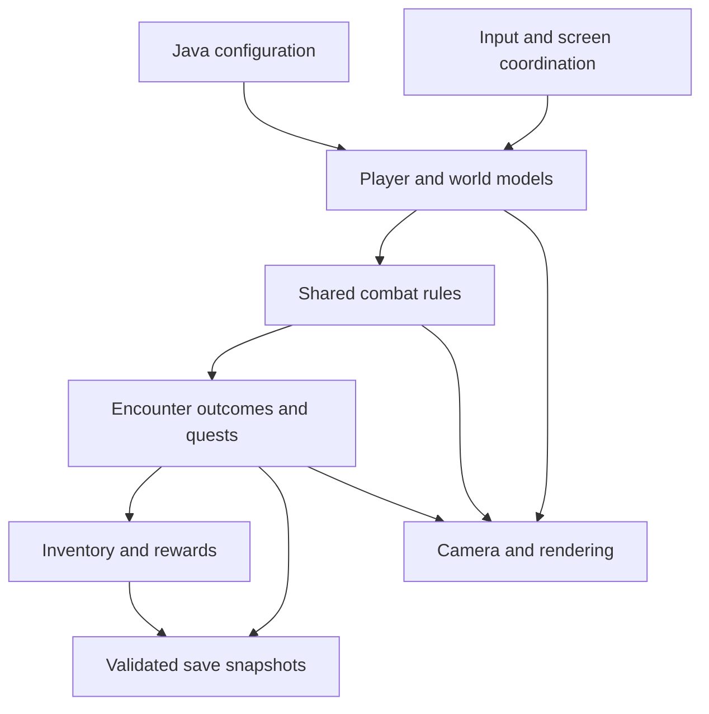

# Game Engine

[Home](home) · [Features](features) · [Game Tester](game-tester)

## Modules and responsibilities

`core` contains game models and most automated tests. `lwjgl3` supplies the desktop launcher and runtime resources. `assets` contains artwork and audio. libGDX provides graphics, input and audio; our engine code implements world rules, combat, encounters, progression and persistence.

| Area | Responsibility / examples |
| --- | --- |
| World | `GameMap`, `MapCatalog`, collision boxes, spawn points and portal destinations |
| Player | Player state, classes, abilities and input commands |
| Combat | Attack/projectile settlement, health, faction checks, elements and status effects |
| Enemy | Enemy AI, pathfinding, two-phase Boss and guardian trait strategies |
| Progression | Encounter outcomes, quest acceptance/completion and NPC services |
| Inventory | Stack ownership, equipment, potions, shared-material upgrades |
| Save | Validated snapshots, independent slots and safe restoration |
| Screen | Gameplay coordination, modal input, rendering, camera, HUD and notifications |

## Configuration and reuse

Maps, class definitions and Boss configuration are Java data objects. For example, changing a class's configured skill tuning changes the values consumed by the shared ability system; changing a guardian trait alters its signature behavior while preserving the common Boss lifecycle. Rebuild after editing configuration. There is no graphical level editor or runtime configuration reload.

Five guardians share a Boss implementation with composed `BossTrait` strategies. Player and enemy attacks share collision, hostility and damage settlement. Equipment bonuses feed that settlement instead of implementing separate damage rules in the UI.

## Configuration trade-offs

Keeping content in configuration objects reduces the need to modify coordination code for tuning changes. External JSON/YAML would separate data more strictly and is a common production approach, but typed Java configuration gives compile-time validation without requiring a parser, schema or editor in this project. libGDX supplies the platform layer while the project implements and tests its own gameplay architecture.

Typed configuration still has a cost: designers must edit Java and rebuild, and presentation assets may need renderer/asset work. We therefore describe it as a configuration-driven Java engine rather than claiming a no-code content editor.

## Simulation flow

The gameplay coordinator advances player abilities and movement, settles combat, processes deferred skill effects, then resolves encounter outcomes. Deferred handling prevents an attack callback from changing maps halfway through settlement. Success/failure cleans up old attacks and returns the player through the existing world-travel boundary.

Movement and dash use collision queries against map geometry. Projectiles use swept collision; fixed attacks and reaction areas require line of sight. Map changes clear map-local attack/status activity so effects do not follow the player into Hub.

Modal interfaces consume their input before movement/skill sampling and pause simulation. NPC-triggered travel synchronizes map bindings without advancing combat during a dialogue frame.

## Persistence boundaries

Snapshots include player state, class choices, cooldowns, location, inventory, chest, equipment, quest progress and relevant NPC/ending flags. Loading validates data before replacing live state; derived equipment bonuses are recomputed. Active combat is excluded by save-location/activity rules. Debug switches are session-only and using them blocks subsequent save writes for that live game.

## Engine examples and limitations

The same damage pipeline supports a player arrow, a Boss bolt, an elemental field and the Training target's upward shot. Training changes outcome rules rather than introducing a separate combat formula. Tests can advance the model with commands and controlled time without creating the desktop window.

The current campaign uses predefined arenas and one Boss per battle. It does not provide procedural dungeon generation, multiplayer, achievements, a general crafting system or a scripting editor.

For implementation details and historical design decisions, see the repository's [architecture document](https://gitlab.comp.anu.edu.au/u7782042/comp2120-fri11_a3_u7782042_u7998420_u7851266_u8350466/-/blob/64310bfa5869a213c6e9025bc6eff2d45effcc3e/Activity_2/docs/ARCHITECTURE.md) and [report index](https://gitlab.comp.anu.edu.au/u7782042/comp2120-fri11_a3_u7782042_u7998420_u7851266_u8350466/-/blob/64310bfa5869a213c6e9025bc6eff2d45effcc3e/Activity_2/docs/README.md). Dated sections describe their recorded development stage.

## Reproducible configuration example

The examples and implementation links below refer to source commit `64310bf` (reviewed 3 October 2026). They illustrate editable Java configuration; no example change is applied to the submitted game.

In [`MapCatalog.createMaps()`](https://gitlab.comp.anu.edu.au/u7782042/comp2120-fri11_a3_u7782042_u7998420_u7851266_u8350466/-/blob/64310bfa5869a213c6e9025bc6eff2d45effcc3e/Activity_2/core/src/main/java/au/edu/anu/comp2120/world/MapCatalog.java), Training has a named entry spawn:

The following expression is an excerpt from the map configuration, not a standalone Java file:

```text
Map.of("entry", new SpawnPoint(80, 80),
       "far-side", new SpawnPoint(680, 480))
```

To try a different Training arrival position, change only that Training entry to `new SpawnPoint(120, 80)`, rebuild and start a fresh game, then use Portal Guide to enter Training. Inspect the arrival location and collision boundaries. Loading a previous save is not a test of a fresh configured spawn. Keep spawn coordinates inside the map and clear of actors/obstacles. Restore `(80, 80)` after the experiment.

```sh
# Run from Activity_2
./gradlew core:test --tests '*MapCatalogTest' --tests '*TravelSystemTest'
./gradlew lwjgl3:run
```

These are reproduction instructions, not a claim that the modified configuration has been executed. Adding a complete new campaign arena also requires portal routing, encounter/quest registration and presentation assets; a map definition alone does not add a playable campaign chapter.

### Module interaction diagram

This diagram summarizes responsibilities; arrows show configuration, commands, results or read-only presentation data, not a separate event-bus implementation.



### Shared gameplay flow

| Stage | Existing responsibility | Observable result |
| --- | --- | --- |
| Configuration | `MapCatalog`, class definitions, `BossTraits` | Select geometry, abilities and guardian behavior |
| Input and simulation | `GameScreen`, player and world models | Apply commands and collision-safe movement; modal interfaces pause simulation |
| Combat | Shared attacks, projectiles, health and elemental rules | Resolve a confirmed hit consistently for player, Boss and Training target |
| Outcome and persistence | Encounter/quest settlement, inventory and save snapshots | Return to Hub, award progress once and write a successful-victory checkpoint |
| Presentation | Camera, renderer, HUD and audio | Display the model state without redefining damage or reward rules |

## Implementation references

- [Architecture and module contracts](https://gitlab.comp.anu.edu.au/u7782042/comp2120-fri11_a3_u7782042_u7998420_u7851266_u8350466/-/blob/64310bfa5869a213c6e9025bc6eff2d45effcc3e/Activity_2/docs/ARCHITECTURE.md): ownership, frame ordering, persistence and historical scope decisions.
- [Guardian traits](https://gitlab.comp.anu.edu.au/u7782042/comp2120-fri11_a3_u7782042_u7998420_u7851266_u8350466/-/blob/64310bfa5869a213c6e9025bc6eff2d45effcc3e/Activity_2/docs/BOSS_TRAIT_REPORT.md): shared Boss lifecycle and five composed behaviors.
- [Art integration](https://gitlab.comp.anu.edu.au/u7782042/comp2120-fri11_a3_u7782042_u7998420_u7851266_u8350466/-/blob/64310bfa5869a213c6e9025bc6eff2d45effcc3e/Activity_2/docs/ART_INTEGRATION.md): resource loading, animation and rendering boundaries.
- [Save/load integration](https://gitlab.comp.anu.edu.au/u7782042/comp2120-fri11_a3_u7782042_u7998420_u7851266_u8350466/-/blob/64310bfa5869a213c6e9025bc6eff2d45effcc3e/Activity_2/docs/SAVE_LOAD_REPORT.md): snapshot validation and restoration.
- [Combat occlusion report](https://gitlab.comp.anu.edu.au/u7782042/comp2120-fri11_a3_u7782042_u7998420_u7851266_u8350466/-/blob/64310bfa5869a213c6e9025bc6eff2d45effcc3e/Activity_2/docs/COMBAT_OCCLUSION_REPORT.md) and [element reaction report](https://gitlab.comp.anu.edu.au/u7782042/comp2120-fri11_a3_u7782042_u7998420_u7851266_u8350466/-/blob/64310bfa5869a213c6e9025bc6eff2d45effcc3e/Activity_2/docs/ELEMENT_REACTION_COMPLETION_REPORT.md): current behavior, design contracts and dated verification boundaries.

## Engine behavior on screen


Wind encounter rendered from shared player, Boss, health and combat state. This capture comes from an unsuccessful attempt; the later normal user victory is recorded separately.

See [Playtest and Screenshots](Playtest-and-Screenshots) for the five-win checkpoint, Hall progression and restored ending, and [Documentation Index](Documentation-Index) for all engine reports.
